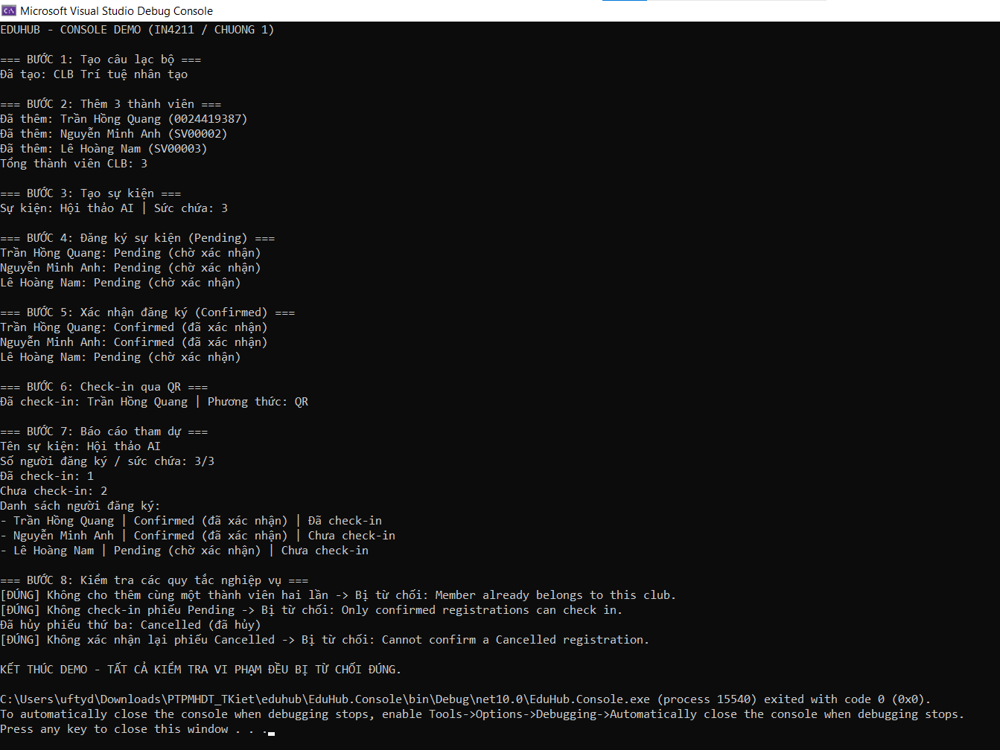

# EduHub

EduHub là ứng dụng minh họa quản lý câu lạc bộ, đăng ký sự kiện và điểm danh sinh viên bằng C# / .NET 10.

## Giới thiệu bản thân

- **Họ và tên:** Trần Hồng Quang
- **MSSV:** 0024419387
- **Email:** 0024419387@student.dthu.edu.vn
- **Trường:** Đại học Đồng Tháp (DTHU)
- **Môn học:** Phát triển phần mềm hướng đối tượng

## Mục tiêu học tập

- Nắm vững kiến thức về phát triển phần mềm hướng đối tượng
- Thực hành sử dụng Git và GitHub trong quy trình phát triển phần mềm
- Xây dựng và triển khai các ứng dụng web hiện đại

## Kỹ năng

- Git & GitHub
- Làm việc nhóm
- Phát triển phần mềm

## Cấu trúc dự án

```text
eduhub/
├── EduHub.Domain/       # Entity và quy tắc nghiệp vụ
├── EduHub.Console/      # Ứng dụng Console Demo
├── docs/
│   ├── class-diagram.md # Sơ đồ lớp Mermaid
│   └── console-demo.png # Ảnh kết quả chạy demo
├── EXPECTED_OUTPUT.txt # Kết quả mong đợi để đối chiếu
└── README.md
```

Tài liệu [User Story](0024419387_TranHongQuang_UserStory.docx) và [sơ đồ lớp](docs/class-diagram.md) mô tả yêu cầu và mô hình EduHub. Domain gồm `Member`, `Club`, `Event`, `Registration`, `CheckIn` cùng các trạng thái thành viên và đăng ký.

## Chạy Console Demo

Yêu cầu: **.NET 10 SDK**. Mở terminal tại thư mục gốc của repository, rồi chạy:

```powershell
dotnet build EduHub.Console/EduHub.Console.csproj
dotnet run --project EduHub.Console/EduHub.Console.csproj
```

Có thể chạy bằng **Visual Studio 2026 (18.0 trở lên)**: mở `EduHub.Console/EduHub.Console.csproj`, đặt `EduHub.Console` làm Startup Project rồi nhấn **Ctrl + F5**.

## Luồng demo

1. Tạo CLB Trí tuệ nhân tạo.
2. Thêm 3 thành viên vào câu lạc bộ.
3. Tạo sự kiện Hội thảo AI với sức chứa 3 người.
4. Tạo 3 đăng ký ở trạng thái `Pending`.
5. Xác nhận 2 đăng ký sang `Confirmed`, giữ đăng ký thứ ba ở `Pending`.
6. Điểm danh thành viên đầu tiên với phương thức `QR`.
7. In báo cáo: **3/3 đăng ký, 1 đã check-in, 2 chưa check-in**.
8. Kiểm tra 3 thao tác vi phạm: thêm thành viên trùng, điểm danh phiếu `Pending` và xác nhận phiếu `Cancelled`; tất cả đều bị từ chối.

Báo cáo ở bước 7 được in trước khi hủy đăng ký thứ ba trong bước 8. Dữ liệu demo được lưu trong bộ nhớ khi chương trình chạy.

## Kết quả demo

Ảnh chụp kết quả chạy thực tế trong Visual Studio:



Đối chiếu luồng nghiệp vụ với [EXPECTED_OUTPUT.txt](EXPECTED_OUTPUT.txt).

---

> *Repository này được tạo trong khuôn khổ môn học PTPMHDT.*
